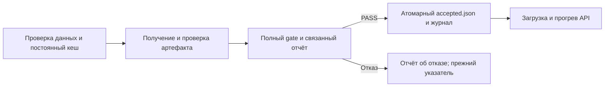

# ДЗ 8–10: выполненная работа

## 1. Код, среда и структура

Репозиторий: https://github.com/zeasshura/mlops-labs, каталог `hw08-09-10`.
Исходный прототип: commit `f40eae0`; исправленная версия: Git tag `hw08-10-fixed`.
Точные SHA: `git rev-parse f40eae0 hw08-10-fixed`.
Исходные HTML, слайды и архив перенесены в `assignment/`. Оба варианта HTML сохранены,
поскольку файлы немного различались. Корневые release/lab/service оставлены совместимыми
с выданными командами и неизменёнными публичными тестами. Нового README и служебных
файлов в корне общего репозитория не добавлялось.

Среда: CPU, 8 доступных логических ядер, 15.27 GiB RAM; модель использует 4 потока,
float32, Python 3.12.15. Prefect 3.6.6, FastAPI 0.118.3, Starlette 0.48.0,
Torch 2.14.0+cpu, Transformers 5.17.0, PEFT 0.21.0, MLflow 2.22.2.
Полный снимок: `environment.json`. Зависимости закреплены `pyproject.toml` и `uv.lock`.
Для быстрых проверок веса и model-extra не нужны. Модельные пакеты на этой машине
переиспользуются через локальный `.pth` нового окружения; для новой машины
предусмотрено `uv sync --locked --extra model`. Старое окружение не изменялось.

## 2. Переиспользование ДЗ 6–7 и настоящая оценка

Повторного обучения и sweep не было. Переиспользован завершённый training run
`4f2095a16b1e48f186a173c2af936b3a`, зарегистрированная версия
`models:/my-qwen-adapter/1`. Исходный evaluation run ДЗ 6–7:
`fbe67256845f4eb0929e596d161259fe`.

Для строгой привязки нового API выполнена новая полная оценка обеих моделей с одним
зафиксированным протоколом: 50 golden-примеров и 3 behavioral-кейса. Это генерация,
а не обучение. Новый evaluation run:
`96f8c4a2b3104f77a4a41fc3d0d6f8fb` в эксперименте `hw8910-release-evaluation`.
MLflow: http://127.0.0.1:5006/#/experiments/3/runs/96f8c4a2b3104f77a4a41fc3d0d6f8fb
(ссылка на сохранённый локальный run).

| Модель | Golden accuracy | Format rate | Behavioral | Решение |
|---|---:|---:|---:|---|
| Qwen3-0.6B, исходная база | 50/50 = 1.00 | 1.00 | 3/3 | Сохранить baseline |
| Адаптер из training run | 9/50 = 0.18 | 0.18 | 2/3 | Отклонить |

База закреплена revision `c1899de289a04d12100db370d81485cdf75e47ca`.
По критическим срезам biology/culture/geography accuracy базы 1/1/1,
адаптера 0.25/0.0667/0.20. Gate из `../hw06-07/evaluation/solution.py` не ослаблялся.
Выпуск кандидата не разрешён по val_loss: зафиксирован отказ из-за регрессии accuracy.
Для первоначально принятой базы выполняется тот же полный gate базы против её полного
отчёта. Это явно политика сохранения baseline, а не принятие плохого кандидата.

`integrate_hw67.py` проверяет состояние training run и привязку registry version,
скачивает готовый адаптер из локального MLflow, закрепляет файлы и runtime,
генерирует настоящие ответы и вызывает исходные score/quality_gate.
Отчёты, сырые ответы и происхождение: `real/`. STUB в эту оценку не включён.

## 3. Граф процесса, кеш и идентичности



Один Prefect-flow `release_flow`, четыре самостоятельные задачи. Передаются только
пути, идентификаторы и хеши; веса и тензоры не передаются между задачами.
Стадия получения проверяет уже обученный артефакт, обучение не запускается.

Реальная подготовка проверяет golden/behavioral/training-index: схему, уникальность,
срезы, обязательные behavioral-типы и отсутствие пересечения train/golden.
На диск сохраняется небольшой отчёт проверки, а не весь датасет как результат задачи.
Ключ `cache_key` — SHA-256 канонического JSON из хеша входных байтов и всех полей config.
Config содержит точную revision/хеш токенизатора, шаблон, max_length и версию кода.
Фактическая версия кода вычисляется из `flow.py`. Порядок полей и имя входного файла
не меняют чистый ключ. Prefect дополнительно изолирует результат по workspace,
поскольку результат содержит локальный путь. `persist_result=True`; результаты и
метаданные кеша сохраняются в `.prefect`, отчёт подготовки — в workspace/cache.
После завершения процесса они остаются доступны следующему процессу.

Идентификатор попытки — новый UUID в attempts/flow-attempts. Идентификатор результата
подготовки — ключ содержимого. Release ID зависит от manifest и связанного report,
включая runtime и evaluation_run_id; одного model_id недостаточно. Повтор публикации
не создаёт новое событие. Журнал попыток и фактические публикации разделены.

## 4. Испытания процесса

Автоматизация: `flow_experiments.py`; журналы и коды: `evidence/flow-runs.json`.
Каждый шаг запускает новый Python-процесс; один локальный Prefect server используется
только на время опыта. При повторении выбрать новые workspace:

```bash
.venv/bin/python flow_experiments.py \
  --workspace .lab-flow-demo --crash-workspace .lab-flow-demo-crash
```

| Опыт | Exit | Доказательство |
|---|---:|---|
| Сбой после подготовки | 1 | `prefect-failed.txt`, PREPARED, указатель прежний |
| Восстановление новым процессом | 0 | `prefect-resumed.txt`, Prefect state Cached |
| Повтор того же выпуска | 0 | `prefect-repeated.txt`, new_event=False, одно событие |
| Новые байты по тому же пути | 0 | `prefect-input-changed.txt`, новый PREPARED/ключ |
| Сбой после указателя до журнала | 1 | `prefect-pointer-crash.txt`, сохранён intent |
| Восстановление после него | 0 | `prefect-pointer-recovered.txt`, одна публикация |
| Повтор восстановления | 0 | `prefect-pointer-repeated.txt`, всё ещё одна публикация |

Два кеш-файла подтверждают реальную инвалидацию входа. Изменения каждого поля config
дополнительно проверяются `test_02`. Схема, несовместимые веса и отрицательный gate
не повторяются автоматически: повтор не исправляет такие ошибки. В flow нет сетевой
стадии, которой нужен retry; полученный training artifact используется локально.

## 5. Допуск и сохранность выпуска

Manifest фиксирует model ID, локальный URI, список относительных имён файлов и их
SHA-256, сводный model_sha256, protocol/golden SHA-256 и полный runtime.
Runtime содержит точную revision базы, tokenizer/template SHA-256, system,
do_sample=False, seed, max_new_tokens=24, enable_thinking=False и dtype=float32.
Тот же TransformersBackend применяется в новой оценке и API. При загрузке и выпуске
повторно проверяются фактические файлы; база закреплена точной HF revision.

`linked_report` заново сверяет сырые ответы, ID, overall/slices/per_item/behavioral,
хеш протокола и текущего кода, затем вызывает исходный quality_gate. Он сохраняет
SHA-256 полных eval и ответов в `source_evidence`; вручную установленный passed не
заменяет gate. Отказ тоже сохранён. Реальный baseline выпущен через Prefect,
реальный кандидат отклонён. SHA-256 accepted.json до/после отказа совпадает:
точные значения в `evidence/real-flow-runs.json`.

Неполный отчёт, чужая версия, NaN, отказ по качеству и mock ошибки диска проверены
публичными и новыми тестами. Отрицательные проверки сохраняют старые байты указателя.
Атомарная запись использует временный файл в том же каталоге, flush/fsync и os.replace.
Незавершённое обновление журнала восстанавливается по pending intent и SHA-256 указателя;
ledger заменяется атомарно, событие уникально по release_id. Конкуренция писателей
не реализована: по условию писатель один. Локальный accepted.json не меняет MLflow alias.

## 6. Быстрые проверки и CI

17 контрактных/дополнительных тестов проходят. Восемь новых интеграционных тестов
падают на исходной версии и проходят на исправленной со stdlib и FastAPI.
Публичные tests/test_release.py и все тесты ДЗ 6–7 не редактировались.
Доказательства: `evidence/before.txt`, `before-contracts.txt`, `contracts.txt`,
`after-stdlib.txt`, `after-fastapi.txt`, `test-runs.json`, `fixes.diff`.
Красные прогоны возвращают exit 1, зелёные — exit 0. `defects.csv` связывает семь причин
с исправлениями и именами проверок. Отдельный файл ошибок: `defects.md`.

Итоговая команда `make check` оставлена владельцу для собственного вывода.
При реализации тесты запускались напрямую. `ci.example.yml` адаптирован к вложенному
проекту и включает сервис/flow/новые тесты в компиляцию и оба HTTP-прогона.
Это шаблон: Actions не запускались, защита merge не заявляется. Локальные доказательства есть.

| Изменение | Конкретные действия |
|---|---|
| Код | `make check`; при изменении backend/генерации — `make real`, затем `flow_experiments.py --real` |
| Данные | Повторная schema/leakage проверка и новый ключ; `make real` для новой оценки. Обучение нужно при изменении тренировочных данных по смыслу задачи; изменение golden само по себе не требует обучения |
| Новый адаптер | Проверить finished run/registry binding и хеши, `make real`; только после полного PASS выпуск через flow |

## 7. Настоящий API

Итоговый сервис: FastAPI, загрузка в lifespan, внедряемый StubBackend/TransformersBackend.
Stdlib-адаптер сохранён для одинаковых быстрых black-box тестов исходного и нового кода.
Health показывает жизнь процесса; ready возвращает 503 до загрузки/проверки/прогрева.
Работает одна генерация одновременно, максимум четыре запроса внутри ограниченной
очереди; переполнение — 429. Пустой/слишком длинный prompt и неверные token limits
получают 4xx до backend. Дополнительная проверка ограничивает вход 2048 токенами.
Настоящий API принимает только оценённый max_new_tokens=24; произвольное уменьшение
не наследует оценку, поэтому тоже отклоняется. Для STUB диапазон 1..32 из контракта.

`real/api-smoke.json`: настоящий ответ базы `{"answer":"A"}`, 219 входных токенов,
6 выходных, generation около 3.18 с. Ответ содержит request_id, фактический model_id,
runtime_sha256, generation/queue/total seconds. Неверные запросы дали 400,
число backend.calls не изменилось. Проверка выполнена на реальном локальном HTTP.
`real/real-reload.json` подтверждает тот же manifest/runtime после нового процесса.
Точные измерения и идентификаторы сохранены в JSON, без округления для вычислений.

## 8. Нагрузка

После настоящего прогрева выполнялся один и тот же prompt и лимит 24. Для медленного
CPU использован разрешённый объём 4+4. Все попытки, включая возможные ошибки,
сохраняются в `real/load-requests.jsonl`; сводка — `real/load-summary.csv` и JSON.
Таблица фактических измерений приведена ниже в разделе «Результаты замера».

При concurrency=2 очередь увеличивает клиентскую задержку, но одна последовательная
модель не начинает вычислять два ответа одновременно. Поэтому req/s почти не растёт.
Generation_seconds измеряет вычисление, queue_seconds — ожидание блокировки,
client_seconds — полную HTTP-задержку. Латентность JSON-ответа не равна TTFT.

Prefill обрабатывает входной контекст, decode последовательно получает новые токены.
KV-cache хранит ключи/значения attention предыдущих токенов, ускоряя decode ценой памяти;
его расход растёт с длиной контекста и числом одновременно обслуживаемых последовательностей.
Это обычный последовательный Transformers backend без continuous batching.
Его измерения не доказывают скорость SGLang/vLLM. TTFT, ITL и устойчивый p95 не измерялись.
Справка: https://huggingface.co/docs/transformers/kv_cache

## 9. Версия и откат

STUB A→B→A проверен настоящим HTTP и сменой процессов в `test_07`:
A загружена → указатель B, но ответ/ID ещё A → restart даёт B → возврат принятой A
и restart снова дают A. Лог `after-fastapi.txt` явно содержит наблюдаемую цепочку.
Это инженерная проверка двух лёгких фикстур, не оценка модели.

Вторая настоящая допущенная модель отсутствует: кандидат отклонён. Поэтому реально
проверены загрузка и перезапуск текущей baseline; сценарий дальнейшей смены такой же:
полный gate → атомарная публикация → управляемый restart → проверка фактического ID/runtime.
При проблеме вернуть предыдущий прошедший gate manifest и выполнить такой же restart.
Само изменение указателя не переобъявляет модель в памяти.

## 10. Артефакты и ограничения

Полные отчёты/ответы/хеши сохранены в Git. Веса, `.venv`, `.runtime`, `.prefect`, кеши и
volumes в Git не входят. Публичная база доступна преподавателю без локального MLflow:
https://huggingface.co/Qwen/Qwen3-0.6B/tree/c1899de289a04d12100db370d81485cdf75e47ca
Локальные URI указывают расположение тех же проверенных файлов на машине автора.
Для переноса скачать эту exact revision и разрешить путь на неё, сохранив файловые хеши.

Источник кандидата — сохранённый MLflow run и исходные volumes `mlops-hw6_artifacts` /
`mlops-hw6_postgres`, доступные при локальном показе по http://127.0.0.1:5006.
Кандидат не нужен для обслуживания принятой базы. Если преподавателю нужны именно его
веса для независимого повтора, автор отдельно предоставляет экспорт артефакта этого run,
не добавляя веса в Git; экспорт/публичная загрузка весов в рамках работы не выполнялись.
Данные ДЗ 6–7 восстанавливаются по существующим DVC pointers и закреплённому read-only
remote в `../hw06-07/.dvc/config`; на этой машине использованы сохранённые исходные данные.

Это учебная малая оценка 50+3 и восемь нагрузочных запросов. Нет GPU-замера,
длительного стресс-теста, удалённого CI, аутентификации внешнего API, multi-writer
публикации, обновления модели без рестарта или вывода о промышленной производительности.
Сервис доступен только на loopback. Дополнительный `/debug` включается для учебного показа.
Стартовые STUB PASS нигде не выданы за качество настоящей модели.
FastAPI lifecycle выбран по официальной документации:
https://fastapi.tiangolo.com/advanced/events/

## 11. Что осталось автору

Самостоятельно запустить `make check` и записать одно видео 5–8 минут.
Ссылка на видео: **будет добавлена автором**.

## Результаты замера

| Concurrency | n | Успехи/ошибки | Пакет, с | Успешных req/s | Средняя задержка, с | Максимальная, с |
|---:|---:|---:|---:|---:|---:|---:|
| 1 | 4 | 4/0 | 12.266 | 0.326 | 3.066 | 3.118 |
| 2 | 4 | 4/0 | 12.349 | 0.324 | 5.416 | 6.329 |

Ошибок и тайм-аутов в этих восьми запросах не было; задержки ошибок не вычислялись (null). Во всех восьми ответах фактически по 6 выходных токенов. Точные значения — в исходном JSONL.
